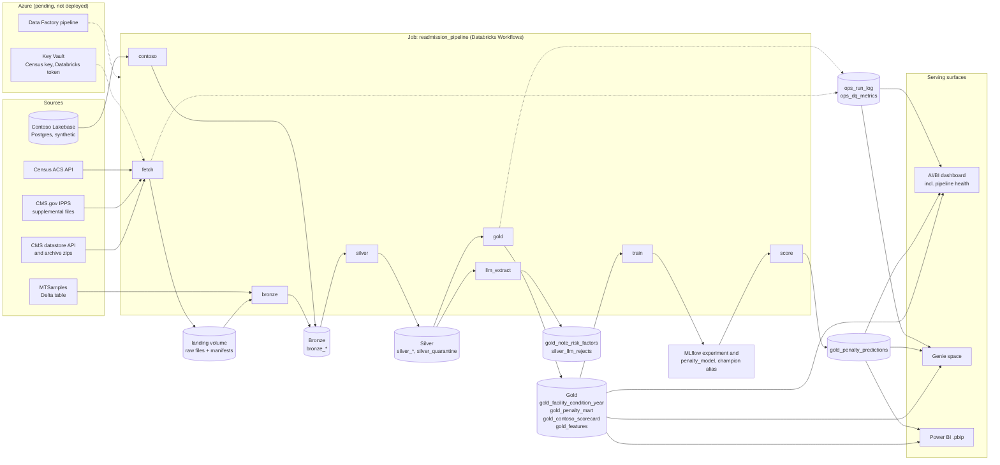

# Architecture

How data moves from the sources through the medallion layers to the model, the LLM step and the
serving surfaces. Contoso Health is fictional. Table names are in Unity Catalog
`workspace.readmission`. The job is `readmission_pipeline` (`resources/readmission_pipeline.yml`).

Solid arrows are data flow. Dotted arrows are control or side effects: every task appends to
the two ops tables (two of the eight are drawn), Key Vault is the planned home of the Census key
and the Databricks token, and Data Factory is planned to start the job. The Azure resources are
defined in Bicep on an unmerged branch and are not deployed (creating them needs Chris's
approval), so nothing in the Azure box has run yet.

## Layers

**Sources and landing.** `fetch` downloads the three current CMS datasets, the FY2019 to FY2026
archive zips, the CMS.gov IPPS files (FY2013 to FY2018 and FY2027) and the Census ACS county
tables, and uploads each raw file unchanged to the landing volume with a manifest. It is pure
Python with retries on 429 and 5xx. Fetch is the only task that calls the internet, so a
blocked domain would change where it runs, not the load code (`docs/data-sources.md`).

**Bronze.** `bronze` reads the landing volume and appends to one Bronze table per source,
adding `_ingested_at`, `_source` and `_batch_id`, and skips batches already loaded. It also
copies the MTSamples notes. `contoso` reads Contoso's Lakebase database over JDBC, incrementally
on an `updated_at` watermark, and writes its own Bronze tables (`docs/lakebase.md`).

**Silver.** `silver` applies explicit schemas, turns CMS suppression codes into nulls and
enforces Delta CHECK constraints. Rows that fail to parse or would break a constraint go to
`silver_quarantine`, and row-count and null-rate expectations fail the run. Table and column
comments, tags and the analyst grant are applied here (`docs/governance.md`).

**Gold.** `gold` builds the facility-condition-year fact, the penalty mart, the Contoso
scorecard and the leakage-safe feature table, and flags anomalies. Penalty cutoffs are CMS's published
values: 1.0 to FY2018, each year's peer group median from FY2019; the few rows CMS published no
median for use 1.0 and are marked so (`docs/gold.md`, ADR 0008).

**ML.** `train` compares a naive rule, logistic regression and LightGBM on `gold_features`
with a time-based split, logs to MLflow and sets the `champion` alias on the registered
`penalty_model`. `score` loads that alias and writes FY2028 probabilities to
`gold_penalty_predictions` (`docs/model-card.md`).

**LLM.** `llm_extract` reads Silver notes, asks a Databricks-hosted model through `ai_query` for
readmission risk factors, validates each answer against a JSON schema and a quote check, and
writes valid answers to `gold_note_risk_factors` and failures to `silver_llm_rejects`
(`docs/llm-extraction.md`).

**Serving.** The AI/BI dashboard (with a pipeline-health page) and the Genie space read Gold,
the predictions and the ops tables; the Power BI project reads the Gold tables listed in
`powerbi/README.md` (`docs/genie.md`).

**Monitoring.** Each task logs a row to `ops_run_log` and its checks to `ops_dq_metrics`. A
failed task emails the job owner and shows on the dashboard's pipeline-health page.

**Azure.** Planned and not yet deployed: Key Vault for the Census key and Databricks token, and
a Data Factory pipeline that starts the job. Until it is deployed, the keys sit in the Databricks
secret scope `readmission`.
