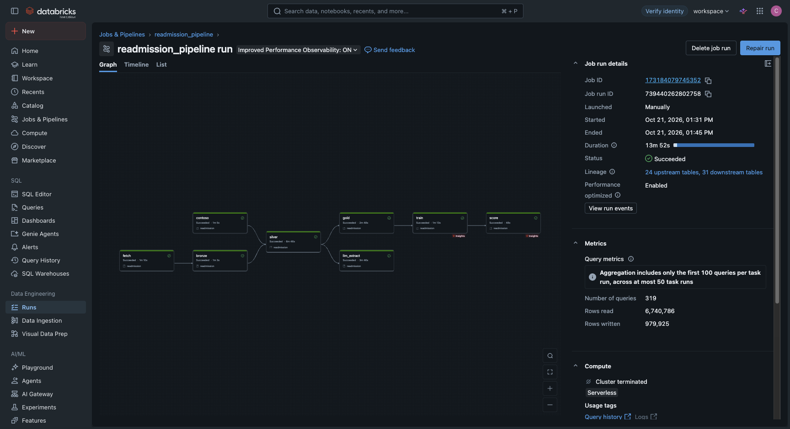
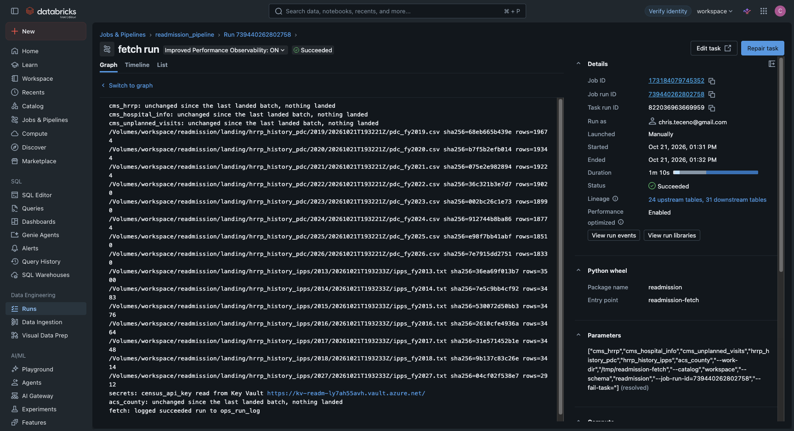

# Azure evidence: Key Vault and ADF (2026-10-21)

Success criterion 6 (SPEC.md): the Key Vault-backed Census key is used by a run, and ADF
triggers the Databricks job at least once. Deployed with `infra/deploy.sh` into resource group
`rg-readmission` (eastus): Key Vault `kv-readm-ly7ah55avh`, Data Factory
`adf-readmission-ly7ah55avhopk`. Setup and design: `docs/azure.md`. Contoso Health is fictional.

## What-if before the deploy

`infra/deploy.sh --what-if` reported `Resource changes: 6 to create`: the factory, the pipeline
`run_readmission_pipeline`, the vault (Standard, RBAC, soft delete 7 days, purge protection
off) and three Key Vault role assignments. That is the list in `docs/azure.md`; nothing else.

## ADF triggers the Databricks job

| ADF pipeline run | Started (UTC) | Duration | Status | Databricks run it started | Databricks result |
|---|---|---|---|---|---|
| `9cd25402-cd83-11f1-8add-4e997100a0d9` | 19:14:19 | 16 min 21 s | Succeeded | `454527841280666` | SUCCESS, all 8 tasks |
| `00df78a6-cd86-11f1-a3b7-4e997100a0d9` | 19:31:25 | 15 min 21 s | Succeeded | `739440262802758` | SUCCESS, all 8 tasks |

Each ADF run read `databricks-token` from Key Vault as the factory's managed identity, called
Jobs API `run-now` for `readmission_pipeline`, polled `runs/get` once a minute, and finished
only after the Databricks run ended in `SUCCESS`.

## The Census key is read from Key Vault

The second ADF-triggered run ran the wheel in which fetch reads the key on every run. Its
`fetch` task (task run `822036963669959`) logged:

```
secrets: census_api_key read from Key Vault https://kv-readm-ly7ah55avh.vault.azure.net/
acs_county: unchanged since the last landed batch, nothing landed
```

A one-off serverless run on the same wheel (run `527366606118407`, `get_secret` only) logged the
same backend line and the sha256 prefix `f7c725a2` of the value it read, which matches the prefix
of the copy in the Databricks secret scope. That proves the vault held the same key. No value
appears in any log.

## Screenshots

Databricks shows "Launched: Manually" for any run started through Jobs API `run-now`, which is
how the ADF pipeline starts it.





To be added: the ADF Monitor page for pipeline run `00df78a6-cd86-11f1-a3b7-4e997100a0d9`
(activity list, all Succeeded).
