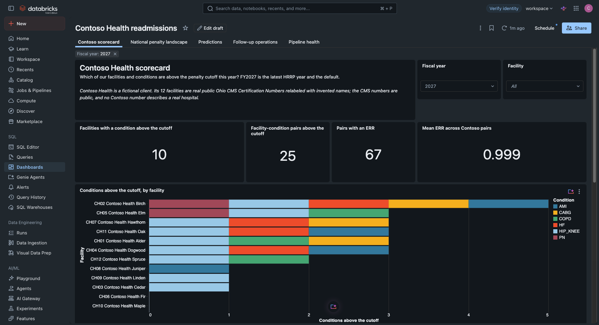
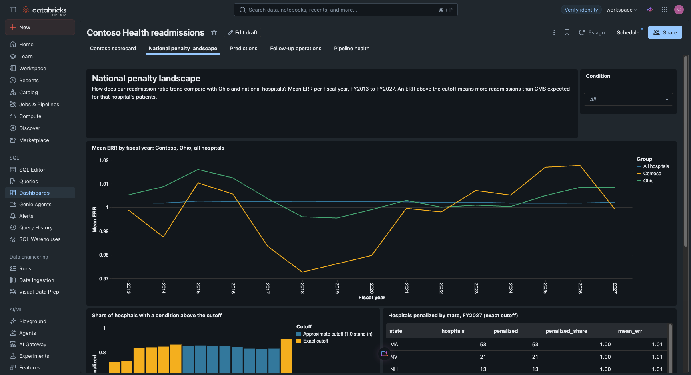
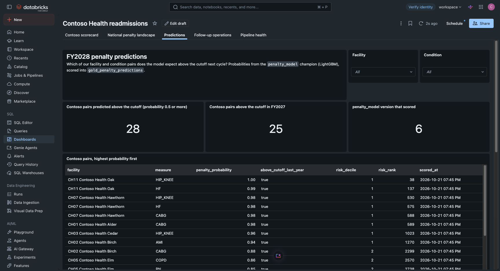
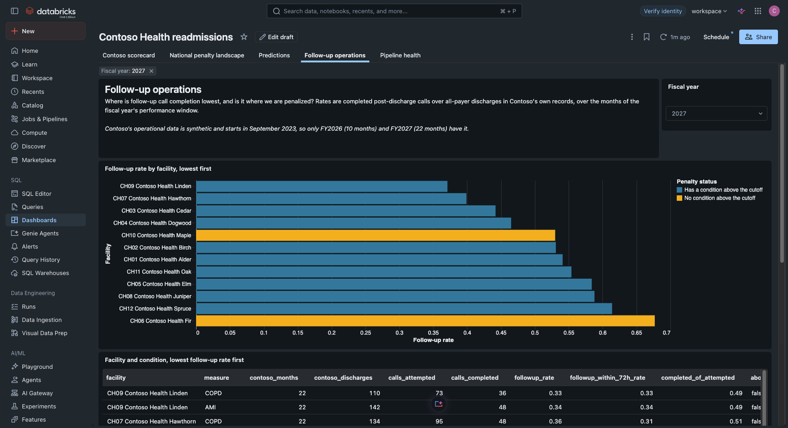
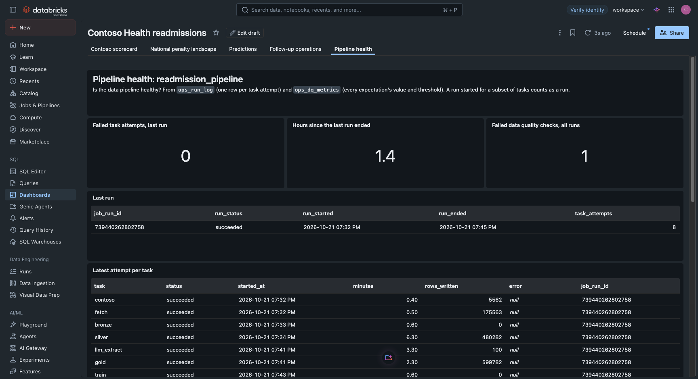
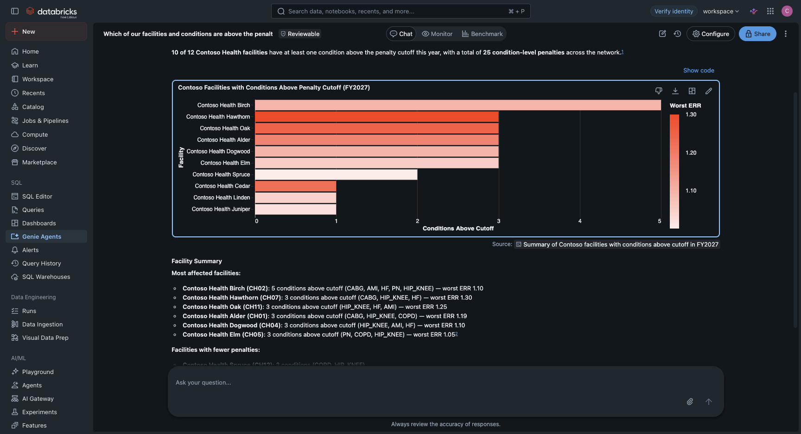
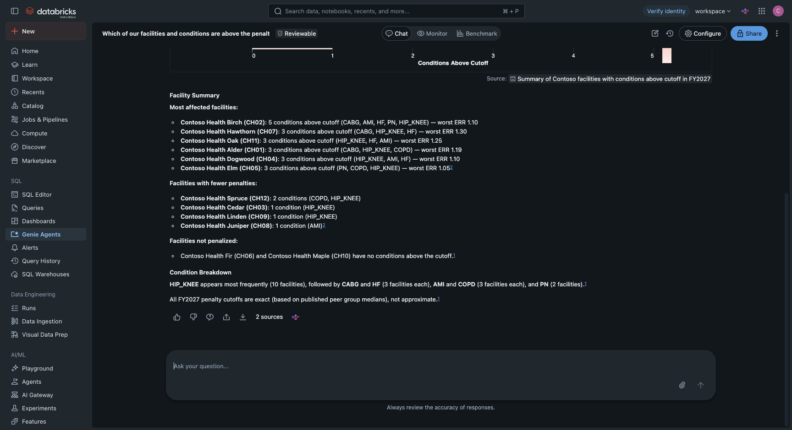

# Dashboard and Genie evidence (2026-10-21)

Screenshots of the published AI/BI dashboard "Contoso Health readmissions" (dashboard id
`01f1cd782bf1143185867b26598d81c0`) and one Genie answer, taken in the signed-in workspace on
2026-10-21. The published dashboard serves cached results, so each screenshot reflects the last
refresh time shown in its header. Contoso Health is fictional.

The earlier `dashboard-<n>-<page>-local-render.png` files, drawn with matplotlib from the page
SQL, were replaced by these real renders and removed.

The first real render showed "Invalid widget definition is imported" on five table widgets and the
Mean ERR counter rounded to 1. The tables now use the table spec version 2 and the counter shows
three decimals; all five pages render with no invalid widget.

## Dashboard pages

| Page | Screenshot | Shows |
|---|---|---|
| Contoso scorecard |  | Counters for facilities and pairs above the cutoff, Mean ERR across Contoso pairs (0.999), the scorecard bar and the facility-condition table |
| National penalty landscape |  | Mean ERR trend, share of hospitals above the cutoff by condition, state table |
| Predictions |  | Penalty model probabilities for FY2028 by facility and condition, model version counter |
| Follow-up operations |  | Follow-up rate by fiscal year and the follow-up table |
| Pipeline health |  | Failed attempts, hours since the last run, failed quality checks, latest run `739440262802758` with its 8 tasks |

The sixth page, "Penalty dollars and follow-up calls" (added 2026-10-26, before Pipeline health),
has no screenshot yet: the published dashboard needs a signed-in browser session, and none was
available to the build. Its five datasets were run on the SQL warehouse on 2026-10-26 and return
the figures in `docs/penalty-dollars.md` (totals $1,959,057 for FY2026 and $1,764,148 for FY2027,
break-even 0.71 and 0.36 points).

The same six pages, penalty dollars included, are also in the public static dashboard
(`site/dashboard/`, no sign-in), with its own render check and screenshot in
[`../static-dashboard.md`](../static-dashboard.md).

## Genie answer

Question 1 (facilities above the cutoff), the answer headline and chart, then the rest of the
answer.

The headline (10 of 12 facilities, 25 pairs) and the per-facility list are right and match the
scorecard. The "Condition Breakdown" sentence miscounts: it says HIP_KNEE 10, HF 3, AMI 3 (sums
to 24), while its own facility list gives HIP_KNEE 9, HF 4, AMI 4 (sums to 25). This is another
case of a wrong summary over a right table; see Known limits in `docs/genie.md`.
