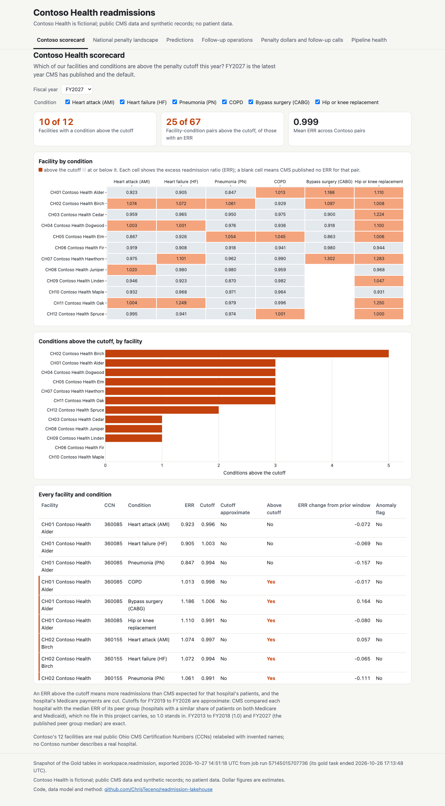

# Public static dashboard

`site/dashboard/` is a public copy of the AI/BI dashboard that needs no Databricks sign-in: a
static page that draws the Gold tables with Plotly.js from a JSON snapshot. The AI/BI dashboard
on Free Edition needs a workspace sign-in and Power BI Desktop needs Windows, so this page is
the one a reader without either can open. It is meant to be copied as is to christeceno.com
(for example to `/readmission/dashboard/`); every path inside it is relative.

Contoso Health is fictional; the snapshot holds public CMS figures and synthetic Contoso
records, and no patient data.

## Pages

The six pages mirror `src/dashboards/readmission.lvdash.json`:

| Page | Shows |
|---|---|
| Contoso scorecard | Fiscal year and condition filters, the counters (10 of 12 facilities and 25 of 67 pairs above the cutoff in FY2027), a facility by condition heat map of the ERR, conditions above the cutoff by facility, the full table |
| National penalty landscape | Mean ERR by year for Contoso, Ohio and all hospitals, the share of hospitals penalized by year, how far each pair's ERR sits from its cutoff in FY2027, the state table; counts and distributions only |
| Predictions | The FY2028 ranking of Contoso's pairs, the 20 highest-risk pairs, mean probability by condition nationally |
| Follow-up operations | Follow-up rate by facility for FY2026 and FY2027, calls by facility and condition |
| Penalty dollars and follow-up calls | Estimated penalties for FY2026 and FY2027 by facility and condition, the timing table, the break-even curve from `gold_penalty_sensitivity`, Contoso's ledger and payer savings in separate tables |
| Pipeline health | The last run, latest attempt per task, task durations, failed quality checks, as of the export |

The page uses one accent color, for "above the cutoff" (and "0.5 or more" on Predictions);
everything else is gray. It follows the reader's light or dark setting, and on a phone the
charts stack and use short labels (CH01 Alder, AMI) with no horizontal page scroll.

## Refreshing the snapshot

```
uv run python scripts/export_dashboard_data.py [--profile readmission]
```

The script runs one SQL query per dataset on the Serverless Starter Warehouse and rewrites
`site/dashboard/data/*.json` (about 470 KB in all). Each query aggregates in SQL and selects only
what the page shows. `meta.json` records the export time and the job run whose `gold` task last
succeeded; the page footer shows both. Rerun it after any pipeline run (for example once the
FY2019 to FY2026 peer medians replace the 1.0 stand-in) and commit the JSON; the captions about
the approximate cutoff are in `index.html` and need editing by hand when that changes.

Names: only Contoso rows carry a name, as the Contoso id and invented name with the real CCN.
`gold_facility_condition_year.facility_name` (the CMS hospital name) is never selected, and the
national page exports counts, never a hospital. `tests/test_site_dashboard.py` fails if any
exported row outside Contoso has a name, city, county or address column, or if a CCN outside
Contoso appears; it also checks that every dataset and field the page reads is in the export,
that the scorecard counters agree with their rows, and that the penalty totals agree with
`docs/penalty-dollars.md`. Pipeline errors are cut to their first line with URLs removed.

## Verification

Rendered with headless Chrome (its own `--user-data-dir`) over the DevTools protocol on
2026-10-27, every page at 1280 and 390 pixels wide in light and dark: no console errors, no
horizontal page scroll. The desktop scorecard in light mode:



To view it locally, serve the folder (`fetch` does not read `file://` URLs):

```
python3 -m http.server 8765 --directory site/dashboard
```
